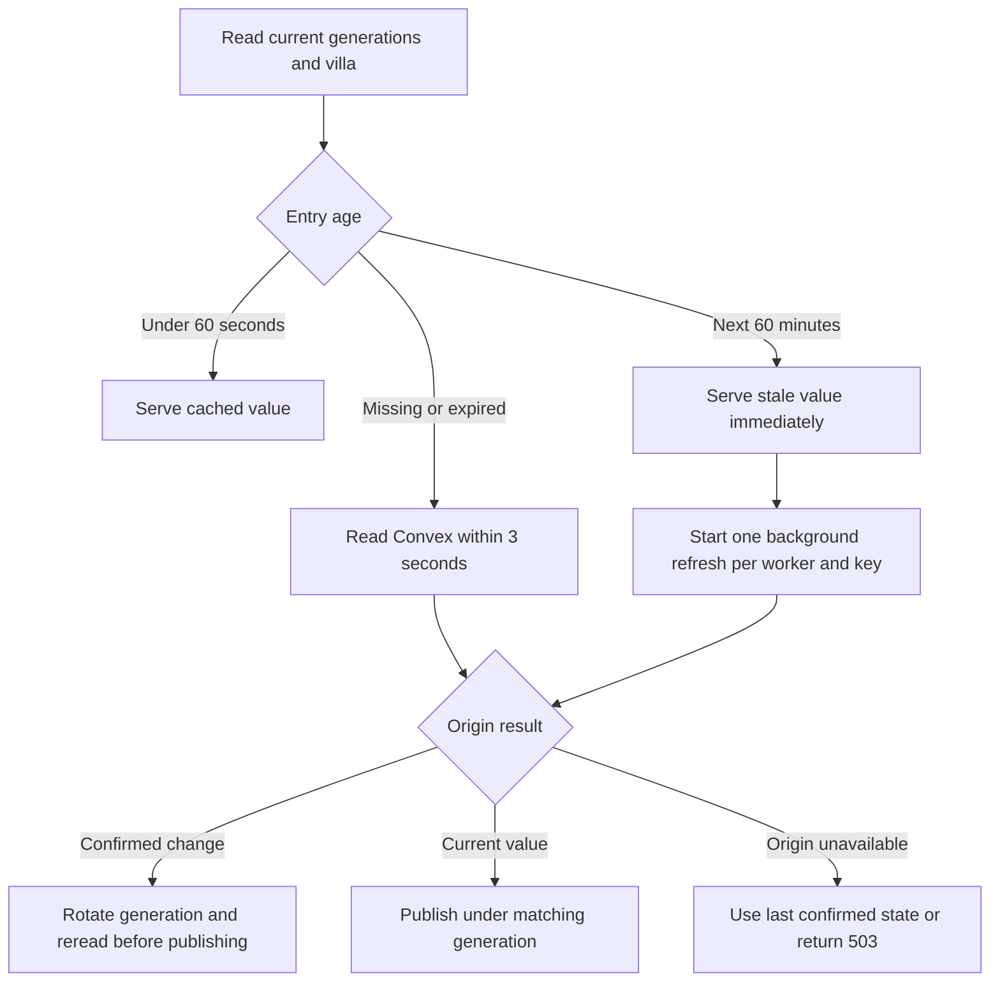

# Controlled Preview room cache

Set `VILLA_BENCH_NAMESPACE=1` on both immutable Preview builds and runtimes. The deployment environment must be `VERCEL_ENV=preview`. The comparator sends `X-Villa-Bench-Namespace` with a fresh 8–48 character lowercase ASCII alphanumeric or hyphen value for each controlled miss, and repeats its priming value for each controlled hit. Natural replay uses a single fresh namespace per arm. The response must echo it in `X-Villa-Cache-Namespace` and report `X-Villa-Cache: hit|miss|stale|recovery|bypass|unconfirmed`. Instrumented responses are private and no-store. The comparator also rejects documents served from Vercel's edge cache.

Next internally rewrites an instrumented document request to a request-time sibling of the room page. The public URL, locale, query, layout, room metadata and render functions are preserved, and the sibling itself returns 404 for direct requests. Normal requests keep the original route and its prerender behavior. The sibling uses Next's `unstable_cache` with the existing 60-second detail policy and a namespaced key. A generation marker identifies whether the request consumed the read run by this callback, a previously cached generation, or a stale generation while the callback refreshes it. Serving the last confirmed villa after an origin failure reports `recovery`. It contributes zero hits to natural replay. A Preview-only Next instrumentation hook attaches the observation to the origin's Node response before headers flush. It uses a middleware-generated request ID only to correlate the render and response in memory.

Start instruments the ordinary request-time room route. It scopes generation keys and benchmark tags to the immutable deployment, and adds the validated namespace only to the DTO entry. Different DTO namespaces reuse the already-established generations. Both generation scopes and benchmark data stay disjoint from ordinary cache keys and tags. The first namespaced request on a fresh candidate is a separate cold-generation diagnostic, outside the measured cohorts. It runs after warming the ordinary app origin. A namespaced miss reads its write back. An unconfirmed write or storage failure never counts as a verified miss. Use `--require-shared-candidate` to require `X-Villa-Cache-Storage: shared` and exclude process-only fallback.

The natural replay keeps every scheduled observation. On Start, a verified miss within a conservative 45-second upper age bound of the last confirmed write could reflect a storage transport error or cache eviction. The report gives the observed hit rate and the optimistic rate if every such miss were a hit. The observed rate still drives the frozen gate.

This comparator measures request-time document rendering plus the server data cache in both arms. Its Next arm does not measure the ordinary route's prerender or CDN delivery, and its private rewrite and response hook are included in measured TTFB. An unauthorized, edge-served or unechoed response supplies no usable sample. The Vercel Preview must demonstrate the origin hook and a primed miss-to-hit transition before cohort data is accepted.

## How a Start detail read is served

The shared cache stores anonymous villa data under a key that includes the environment, Convex deployment, DTO version, slug and two generation tokens. Changing either token makes older writes unreachable. The per-slug token also records whether the villa is active or absent.



An active-to-missing or missing-to-active transition waits up to one second for shared storage to confirm the new polarity. An older fill cannot store an active villa under a negative generation. Known missing villas retain their 404 during outage recovery. A previously unseen slug returns 503 with `Retry-After: 30` during backend backoff. Sitemap failures use separate recovery state.

The hosted post-expiry pilot checks `X-Villa-Cache-Storage: shared` on each request and fails if Vercel supplies only process-local storage. Run it after updating the pinned Vercel SDK or changing the server runtime. The matched comparator checks the same property with `--require-shared-candidate`. [Pilot implementation](../../../scripts/bench/room-preview-swr.mjs)

## What a guest sees after a write

The first guest after the 60-second freshness window can receive the previous villa while the worker refreshes it. Under light traffic, a value written 61 minutes earlier has expired from shared storage and the next caller waits for Convex. Under sustained origin failure the separate recovery policy can continue serving a worker's last confirmed villa. Hard expiry served 69 of 100 replay requests from cache, compared with 99 on Next. The matched replay evaluates the replacement policy. The authenticated, push-disabled study observed the archive at 61.2 seconds and reactivation at 62.4 seconds. [Hosted edit, archive and outage observations](start-villa-preview-outage/swr/attempt6-86a3b5cd-passed.json)

| Write | How it reaches guests |
| --- | --- |
| Edit, rename, publish or archive a villa, change its room order, or edit reviews for an active villa | The catalog mutation schedules invalidation in its transaction. Once the app acknowledges it, subsequent reads use a new cache generation for the affected slug and indexes. Without delivery, guests follow the freshness window above. |
| Create or duplicate a property, edit its draft or delete a draft | The configuration writer operates on a draft. Publication goes through the status mutation above. |
| Change a scene's name, panorama or hotspots | Open tours subscribe directly to Convex. Those fields come from the live rooms query. The villa HTML cache contains the property's ordered room slugs and reviews. Adding, deleting or reordering a scene also updates those slugs through the catalog writer. |
| Seed or import data directly | A bulk import bypasses the application writers. Start with a new cache namespace or expire the affected shared generations as part of the restore. Without invalidation, a populated namespace follows the freshness window above. |

For push delivery, configure the exact Start origin in `START_VILLA_INVALIDATION_ORIGIN` on Convex and the matching server-only `START_VILLA_INVALIDATION_SECRET` in Convex and the Start deployment. Check acknowledgement on the staged origin before promotion. The delivery action retries transient failures. [Catalog edit policy](../../../convex/catalog/private/propertyEdits.ts) · [Delivery and retries](../../../convex/catalog/private/villaInvalidation.ts)

## Post-expiry SWR pilot

Run the pilot before starting a full comparison on a candidate that adds stale-while-revalidate. The runner takes a cold prime and checks three responses in the same unique namespace. It requires a fresh hit, waits until 65 seconds after the prime, requires a plain stale response, and checks for a refreshed hit five seconds later. The local fixture must issue exactly two detail reads across the four requests. The hosted pilot requires shared cache storage, real origin execution, private/no-store, and an immutable Preview in the requested region.

```sh
mkdir -p output/swr-pilot
START_VILLA_CACHE_STUDY=1 START_VILLA_CACHE_SWR_PILOT=1 \
  node scripts/heavy.mjs node scripts/local-integration.mjs --start -- \
  node scripts/bench/room-preview-swr.mjs --local --out output/swr-pilot/local.json

node scripts/bench/room-preview-swr.mjs --deployment dpl_CANDIDATE --scope TEAM \
  --region iad1 --out output/swr-pilot/hosted.json
```

The local command requires the dedicated Clerk test configuration. The hosted command uses the operator’s Vercel CLI login. Both require a new private output path and make read-only room requests.

For a separately reported natural replay, add `--natural-only` to the same comparator command. Both arms still use the frozen schedule and origin, document, namespace, cookie and hit-rate checks. Controlled observations and Start natural observations require native cache response headers. A Next natural observation can also come directly from the instrumented SSR document if the response carries the request’s validated namespace and proxy-generated request witness and the rendered observation matches both. The report retains the observation source without retaining the witness.
